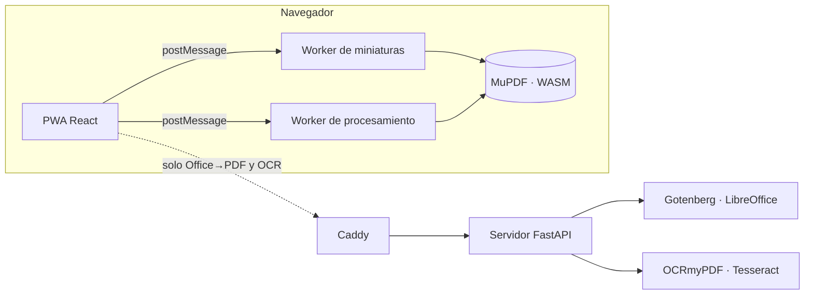

# PrysmaStudio

[](https://github.com/torresjr94dev/PrysmaStudio/actions/workflows/ci.yml)
[](LICENSE)

**Herramientas PDF que trabajan en tu navegador. Tus archivos no se suben a ningún lado.**

Une, divide, organiza, comprime y protege PDF directamente en tu equipo, sin registro y sin límites.
Pensado para los trámites en México: INE por ambos lados, CFDI del SAT a PDF, papel oficio y compresión
al peso exacto que pide cada portal.

## Herramientas

| Herramienta | Dónde corre | Qué hace |
|---|---|---|
| INE por ambos lados | Tu equipo | Frente y reverso en una hoja, a tamaño real, en Carta u Oficio |
| CFDI (XML) a PDF | Tu equipo | Factura, nómina o complemento de pago del SAT como PDF legible, con QR, sellos y cadena original |
| Comprimir PDF | Tu equipo | Presets o «que pese menos de X MB» para portales con límite |
| Unir PDF | Tu equipo | Arrastra para elegir el orden |
| Dividir PDF | Tu equipo | Cortes con tijeras entre páginas, cada N páginas o todas por separado |
| Organizar páginas | Tu equipo | Reordena, gira, duplica y elimina con miniaturas y drag & drop |
| Rotar PDF | Tu equipo | Clic en una página para girarla, o todas a la vez |
| Imágenes a PDF | Tu equipo | JPG/PNG a PDF, con la orientación de las fotos de celular corregida |
| Proteger con contraseña | Tu equipo | Cifrado AES-256 y permisos de impresión y copia |
| Quitar contraseña | Tu equipo | Si conoces la contraseña, genera una copia sin cifrado |
| Word, Excel o PowerPoint a PDF | Tu servidor | LibreOffice aislado, sin acceso a internet |
| Hacer PDF buscable (OCR) | Tu servidor | Tesseract en español e inglés, con salida PDF/A opcional |

Las herramientas marcadas «Tu servidor» solo aparecen si despliegas el servidor opcional. La interfaz
avisa antes de subir cualquier archivo, y el servidor lo borra en cuanto lo descargas.

## Cómo funciona



- **Todo lo local corre en Web Workers** con [mupdf.js](https://mupdf.com/) compilado a WebAssembly. El
  motor (~4.8 MB comprimido) se descarga la primera vez que usas una herramienta y desde ahí funciona
  sin conexión.
- **La promesa «no se sube» es auditable**: la Content-Security-Policy solo permite conexiones al mismo
  origen (`connect-src 'self'`), así que el navegador bloquearía cualquier envío a un tercero.
- **El servidor es opcional y de un solo nodo.** Los archivos viven en tmpfs (memoria), el contenedor no
  tiene salida a internet y cada trabajo se purga al descargarse o al expirar (1 h por defecto).

## Desarrollo

Requisitos: Node ≥ 24, pnpm 12 (`corepack enable`), [uv](https://docs.astral.sh/uv/) y Docker.

```bash
pnpm install
pnpm dev            # http://localhost:5173: las 10 herramientas locales
```

Para las herramientas de servidor en desarrollo (Vite redirige `/v1` al puerto 8080):

```bash
# Terminal 1: LibreOffice aislado
docker run --rm -p 3000:3000 gotenberg/gotenberg:8.38.1-libreoffice

# Terminal 2: API
cd server
PRYSMA_WORK_DIR="$PWD/.work" PRYSMA_GOTENBERG_URL=http://localhost:3000 uv run python -m prysmastudio.main
```

El OCR local además necesita `brew install tesseract tesseract-lang ghostscript` y `uv sync --extra ocr`.
Sin eso, la herramienta simplemente no aparece.

### Pruebas

```bash
pnpm typecheck                     # TypeScript del motor, la PWA y las E2E
pnpm test                          # motor (vitest)
cd server && uv run pytest         # servidor
cd server && uv run ruff check .   # lint del servidor

# E2E con Playwright contra el build de producción (sin servidor)
pnpm --filter @prysmastudio/web exec playwright install chromium
pnpm --filter @prysmastudio/web e2e

# E2E contra el stack completo (CSP real, OCR y LibreOffice incluidos)
E2E_BASE_URL=https://localhost:8443 pnpm --filter @prysmastudio/web e2e
```

Las E2E verifican el **contenido** de cada PDF descargado (orden, giros, cifrado) y fallan si la CSP
bloquea algo. El CI corre todo esto en cada push, incluidas las E2E contra `docker compose`.

## Despliegue en tu servidor

Un VPS con Docker basta. Caddy obtiene el certificado TLS automáticamente.

```bash
cd deploy
cp .env.example .env    # edita al menos PRYSMA_DOMAIN y PRYSMA_SOURCE_URL
docker compose up -d --build
```

| Variable | Por defecto | Para qué |
|---|---|---|
| `PRYSMA_DOMAIN` | *(obligatoria)* | Dominio público; Caddy emite el certificado |
| `PRYSMA_SOURCE_URL` | *(obligatoria)* | URL pública del código que corres (lo exige la AGPL) |
| `PRYSMA_ACCESS_KEYS_SHA256` | vacío | Hashes de llaves de acceso: vuelve privado el servidor |
| `PRYSMA_MAX_UPLOAD_MB` | `100` | Tamaño máximo por archivo subido |
| `PRYSMA_MAX_PAGES` | `300` | Páginas máximas para OCR |
| `PRYSMA_MAX_CONCURRENT_JOBS` | `2` | Trabajos simultáneos (el resto espera en cola) |
| `PRYSMA_JOBS_PER_MINUTE_PER_IP` | `10` | Límite de trabajos por IP |
| `PRYSMA_JOB_TTL_SECONDS` | `3600` | Vida máxima de un trabajo sin descargar |
| `PRYSMA_OCR_THREADS` | `2` | Hilos de Tesseract por trabajo |
| `PRYSMA_WORK_TMPFS` | `2g` | Memoria para archivos en proceso |
| `PRYSMA_SERVER_MEMORY` / `PRYSMA_GOTENBERG_MEMORY` | `4g` / `2g` | Límites de memoria de los contenedores |
| `PRYSMA_HTTP_PORT` / `PRYSMA_HTTPS_PORT` | `80` / `443` | Puertos publicados |

El servidor también acepta `PRYSMA_MAX_PENDING_JOBS` (20) y `PRYSMA_JOB_TIMEOUT_SECONDS` (600), pero
`compose.yaml` no los expone: si los necesitas, agrégalos al servicio `server`.

### Instancia privada

Genera una llave y su hash:

```bash
python3 -c "import secrets,hashlib; k=secrets.token_urlsafe(24); print(k); print(hashlib.sha256(k.encode()).hexdigest())"
```

Reparte la llave (primera línea) a quien deba usar el servidor y pon solo el hash en
`PRYSMA_ACCESS_KEYS_SHA256`, separando varios con comas. Las herramientas locales siguen funcionando
sin llave.

## Estructura

```
apps/web/          PWA (React + Vite): interfaz, service worker, E2E
packages/engine/   Motor PDF: operaciones sobre mupdf.js, worker y cliente con cola
server/            Servidor opcional (FastAPI): Office→PDF y OCR
deploy/            Dockerfiles, compose y Caddyfile con las cabeceras de seguridad
```

## Próximamente

- Tapar datos personales (CURP, RFC) antes de compartir un documento
- Firma con e.firma (PAdES)

## Licencia

[AGPL-3.0-or-later](LICENSE). Si ofreces PrysmaStudio como servicio en red, debes poner a disposición de
sus usuarios el código fuente que corres, con tus modificaciones incluidas. Por eso el build de
producción exige `PRYSMA_SOURCE_URL` y la interfaz enlaza el código en el pie de página.
